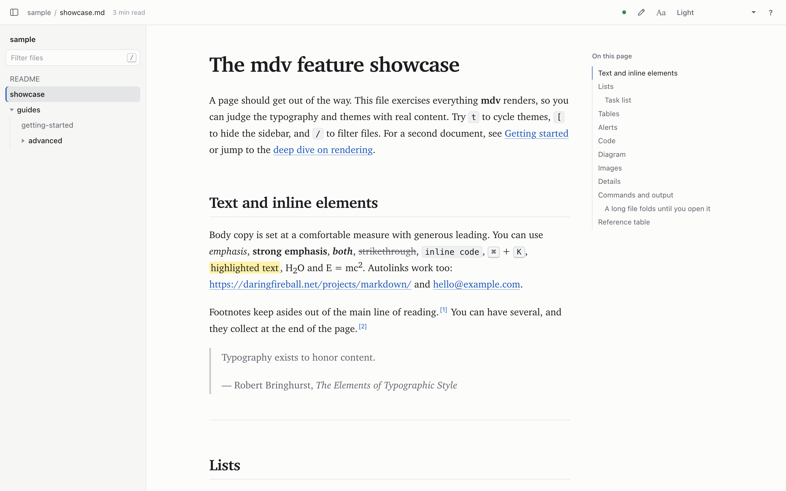
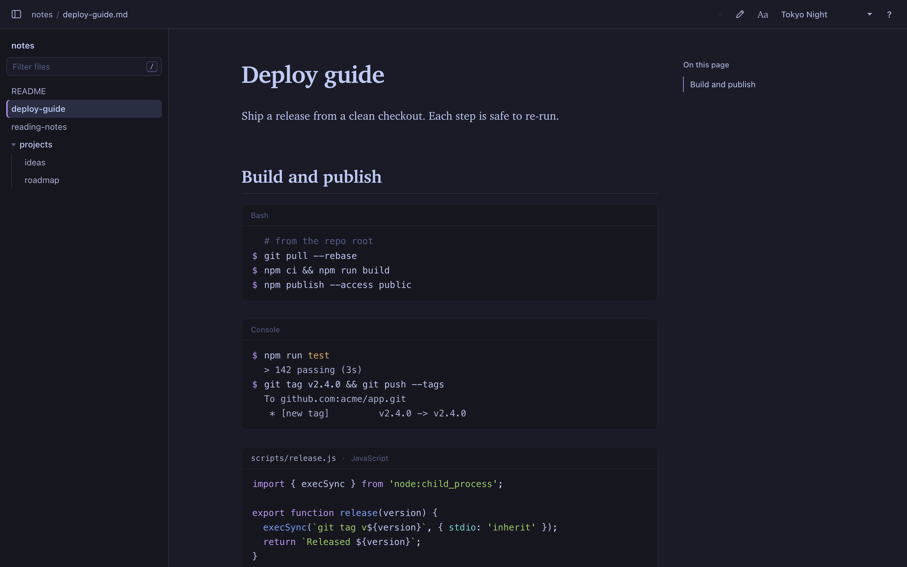
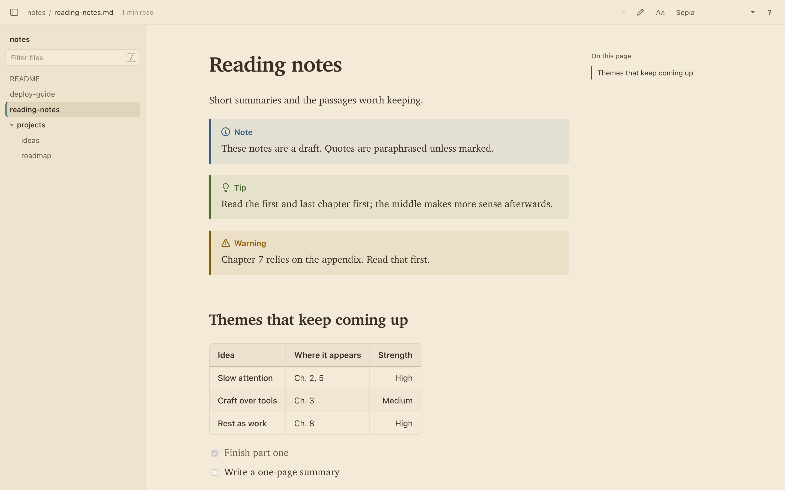

# mdv

[](https://github.com/ateebasif/md-viewer/actions/workflows/test.yml)

**A fast, offline Markdown viewer for macOS.** Point it at a file or a folder and it opens a
clean, themed page in your browser that updates as you save. It's built for reading, not
editing: good typography, 18 themes, 15 fonts, and no Electron.

```bash
mdv README.md      # one file
mdv ~/notes        # a whole folder, with a sidebar of every Markdown file
mdv                # the current folder
```



<table>
  <tr>
    <td></td>
    <td></td>
  </tr>
</table>

## Features

- **Reads like a book.** A comfortable line length, generous spacing and a clear type
  scale. Pick from 15 typefaces, including Literata, Atkinson Hyperlegible and OpenDyslexic,
  and adjust size, width and line spacing.
- **18 themes,** from Light, Sepia and an e-ink style Ink theme to Solarized, Gruvbox,
  Catppuccin, Rosé Pine, Tokyo Night and Dracula. Each has matching code colors.
- **Live reload that shows what changed.** Save in any editor (or let an AI tool rewrite
  the file) and the page updates in place. Changed paragraphs flash and keep a margin mark,
  and a small pill steps you through them.
- **Picks up where you left off.** Each document remembers your place, and ⌘K lists your
  recently opened files.
- **Backlinks, link previews and broken links.** See which documents link to the one you're
  reading, hover a link to preview where it goes, and spot links to missing files or
  headings before you click them.
- **⌘K search across a folder.** File names, headings and full text, ranked, with
  highlighted snippets. Enter jumps straight to the section or the exact passage.
- **Folders.** A sidebar lists every Markdown file, with filtering (`/`), next/previous
  navigation and a sticky table of contents. Files that changed since you last read them
  get a dot.
- **Fold sections, focus mode, sortable tables.** Collapse a long doc to its outline, hide
  everything but the text, and click a table header to sort.
- **Everything GitHub renders:** tables, task lists, footnotes, alerts (`[!NOTE]`,
  `[!WARNING]`…), Mermaid diagrams, heading anchors and front matter.
- **Code that's easy to scan.** Syntax highlighting, copy buttons, `$` prompts on shell
  commands (left out when you copy), terminal sessions with dimmed output, file names in
  headers, whole-line diffs, and long blocks that fold.
- **Finder integration.** Open With, drag and drop onto the app, a "View in MDView" Quick
  Action, or set it as your default Markdown app.
- **Private and offline.** It runs on `127.0.0.1` only and never loads anything from a CDN.
  It serves only the folders you open, and only to a browser you opened it in.

## Requirements

- macOS (it relies on `open`, Finder and macOS fonts, and has only been tested there)
- [Node.js](https://nodejs.org) 18 or newer, or [Bun](https://bun.sh)

## Install

```bash
git clone https://github.com/ateebasif/md-viewer.git
cd md-viewer
./install.sh
```

The installer:

1. Installs dependencies (`bun install` if Bun is available, otherwise `npm install`).
2. Links `mdv` into `~/.local/bin`, or `/usr/local/bin` if that's the writable one. If the
   folder isn't on your `PATH`, it prints the line to add to `~/.zshrc`.
3. Builds **MDView.app** into `~/Applications` and registers it, so it appears under
   **Open With** for Markdown files and folders.
4. Installs a Finder Quick Action called **View in MDView**.

Then try the sample:

```bash
mdv sample
```

> [!NOTE]
> The app and the Quick Action call Node by its absolute path, because apps opened from
> Finder don't get your shell `PATH`. If you switch Node versions (with nvm, say), run
> `./install.sh` again.

## Usage

```
mdv [file.md | folder] [options]
```

| Option | What it does |
| --- | --- |
| `--port <n>` | Port to use (default `4747`) |
| `--theme <name>` | Start with a theme, e.g. `sepia`, `solarized-light`, `mocha`, `tokyo-night` (remembered) |
| `--editor <app>` | App the **Edit** button opens files in, e.g. `"Visual Studio Code"` or `Cursor` (saved; `--editor ""` resets) |
| `--no-open` | Print the URL instead of opening a browser tab |
| `--stop` | Stop the running server |
| `--foreground` | Run the server in this terminal instead of in the background |
| `-h`, `--help` | Show help, including every theme name |
| `-v`, `--version` | Show the version |

Only one server runs at a time. If it's already running, `mdv` hands it the new path and
opens another tab. The server runs in the background, logs to `~/Library/Logs/mdv.log`, and
quits after 30 minutes with no tabs open.

**Folders:** mdv lists every `.md`, `.markdown`, `.mdown` and `.mkd` file in the folder and
its subfolders, skipping `node_modules`, `.git` and hidden folders. A `README.md` or
`index.md` opens first. To browse just part of a project, open that subfolder
(`mdv docs/guides`). The sidebar follows the folder you opened most recently, so
`mdv docs` widens it again.

**Links:** links inside a document open in a new tab, and links to other Markdown files open
in the viewer. `#section` links and footnotes stay in the current tab. Relative images
(``) load from the Markdown file's own folder.

### From Finder

- **Open With:** right-click a `.md` file or a folder and choose **Open With → MDView**.
- **Quick Action:** right-click and choose **Quick Actions → View in MDView**. If it's
  missing, turn it on in System Settings → Keyboard → Keyboard Shortcuts → Services → Files
  and Folders.
- **Drag and drop** files or folders onto MDView in `~/Applications` or the Dock.
- **Open MDView.app by itself** to pick a file or folder.

To make MDView the default for `.md` files, select any `.md` file in Finder and press **⌘I**.
Under **Open with**, choose **MDView** (use **Other…** and browse to `~/Applications` if it
isn't listed), then click **Change All…**.

## Keyboard shortcuts

| Key | Action |
| --- | --- |
| `⌘K` / `Ctrl+K` | Search file names, headings and text (`↵` opens, `⌘↵` opens in a new tab) |
| `t` | Cycle themes |
| `s` | Reading settings: typeface, size, width, spacing, code font |
| `/` | Filter the sidebar file list (`Enter` opens the first match) |
| `[` | Show or hide the sidebar |
| `n` / `p` | Next or previous file in the folder |
| `c` / `⇧C` | Next or previous change after a live reload |
| `f` / `⇧F` | Fold the current section / fold everything to an outline |
| `z` | Focus mode (`z` or `Esc` to leave) |
| `e` | Open the file in your editor |
| `r` | Reveal the file in Finder |
| `+` / `-` | Larger or smaller text |
| `?` | Show all shortcuts |

The dot in the top bar shows live reload: green means connected, amber means reconnecting.
Drag the edge of the sidebar or the table of contents to resize it, and double-click the
edge to reset it.

## Search

Press **⌘K** (or **Ctrl+K**, or click **Search** in the top bar) to search the folder you
opened:

- **Files** by name or title
- **Sections**: every heading in every document. Choosing one opens the file at that heading.
- **Text**: full-text matches with a snippet. Choosing one scrolls to the passage and briefly
  highlights it.

Results are ranked with exact file and heading matches first. Use `↑`/`↓` to move, `↵` to
open, and `⌘↵` to open in a new tab. With a single file open, search covers that file.
Search runs locally, reads only folders you've opened, and keeps up with your edits.
The browser's own **⌘F** still finds text on the current page.

## Following changes

When the open file changes on disk, mdv compares the new version with what you were looking
at:

- **Changed or new** paragraphs, headings, list items, table rows and code blocks flash
  briefly and keep a thin mark in the margin.
- A pill in the corner says how many changed (and how many blocks were removed). Use its
  arrows, or `c` / `⇧C`, to jump between changes, and **×** to clear the marks.

Your scroll position stays put while this happens.

**Resume reading.** Opening a document you've read before returns you to where you stopped.
Reloads and section links still go where you'd expect. With nothing typed, ⌘K shows your
recently opened documents.

**Updated since you last read.** mdv remembers when you last opened each file. In the
sidebar, files modified since then get a dot, and the **N updated** chip under the filter
shows only those files. This is handy when an AI tool or a teammate edits several docs at
once.

**Backlinks.** At the end of each document, **Linked from** lists the other files in the
folder that link to it, with the line that contains the link.

**Link previews.** Hover a link to another Markdown file, or to a heading on this page, and
a card shows that section (or the start of the document) without leaving the page. It also
works when a link has keyboard focus. Press `Esc` or move away to close it.

**Broken links.** Links to a file that doesn't exist, or to a heading that isn't there (in
another file or on the same page), get a wavy underline and a ⚠ with the reason on hover.
Missing images get a dashed outline. Open
[`sample/guides/broken-links.md`](sample/guides/broken-links.md) to see it.

## Reading long documents

- **Fold sections.** Hover a heading and click its arrow, or press `f`, to collapse that
  section. `⇧F` folds everything down to an outline of the top-level sections and unfolds it
  again. Following a link, a search result or a change into a folded section opens it.
- **Focus mode.** Press `z`, or use **Aa → Focus**, to hide the sidebar, the contents and
  the top bar. Only the text and the reading-progress line stay. Move the mouse to the top
  to bring the bar back, and press `z` or `Esc` to leave.
- **Sortable tables.** Click a column header (or focus it and press `Enter`) to sort
  ascending, again for descending, and a third time to go back to the original order.
  Numbers sort as numbers, including `1,200`, `45%` and `$9`.

## Themes

**System** (the default) follows macOS light and dark mode.

| Light | | Dark | |
| --- | --- | --- | --- |
| **Light** | Neutral white, blue links | **Dark** | Neutral charcoal |
| **Sepia** | Warm paper, teal links | **Dusk** | Deep indigo, lavender links |
| **Ink** | E-reader black on white | **Fjord** | Cool slate, frost blues |
| **Moss** | Soft sage paper | **Midnight** | True black for OLED screens |
| **Solarized Light** | Classic low contrast | **Solarized Dark** | Solarized on deep teal |
| **Gruvbox Light** | Retro, earthy | **Gruvbox Dark** | Warm retro dark |
| **Catppuccin Latte** | Soft pastels | **Catppuccin Mocha** | Pastels on dark |
| | | **Rosé Pine** | Muted, low glare |
| | | **Tokyo Night** | Cool night blues |
| | | **Dracula** | Vivid, high contrast |

## Fonts

Open **Aa** (or press `s`) to choose:

- **Serif:** Charter (default), Iowan Old Style, Literata, Source Serif, Palatino,
  Baskerville, Georgia, and New York (Safari only).
- **Sans:** San Francisco, Inter, Avenir Next, Helvetica Neue, Optima.
- **Legibility:** Atkinson Hyperlegible (designed for low vision) and OpenDyslexic.
- **Code:** SF Mono, Menlo or JetBrains Mono.

Literata, Source Serif, Inter, Atkinson Hyperlegible, OpenDyslexic and JetBrains Mono ship
with mdv through [Fontsource](https://fontsource.org), so they work offline. Each is
downloaded from the local server only when you pick it. The rest come with macOS, and fonts
your browser can't use are hidden.

## Writing tips

mdv renders standard Markdown, plus a few info-string extras for code blocks:

````markdown
```console
$ mdv --version
1.0.0
```

```js title="src/app.js"
export const hello = () => 'world';
```
````

- In ` ```bash `, `sh` and `zsh` blocks, each command gets a `$` prompt that isn't copied.
  Comments, `\` continuation lines and scripts with `if` or functions don't get one.
- In ` ```console ` blocks, write `$ command` followed by its output. **Copy** takes only the
  commands.
- ` ```js title="file.js" `, ` ```js file.js ` and ` ```js:file.js ` all show a file name.
- ` ```diff ` blocks color whole lines.

Open [`sample/showcase.md`](sample/showcase.md) with mdv to see every element.

## Troubleshooting

**Nothing opens from Finder the first time.** For files in Downloads, Documents or Desktop,
macOS asks whether MDView may access that folder, and nothing happens until you click
**Allow**. You can review this in System Settings → Privacy & Security → Files and Folders.
Re-running `./install.sh` can make macOS ask again.

**The page says "Open this page with mdv".** mdv only shows files in a browser it opened
itself (see [Security](#security)). Run `mdv <path>` again.

**`mdv: command not found`.** Add the link folder the installer printed to your `PATH`, for
example `export PATH="$HOME/.local/bin:$PATH"` in `~/.zshrc`.

**Port 4747 is busy.** Use another one: `mdv --port 4848 notes.md`.

**Something looks wrong.** Check `~/Library/Logs/mdv.log`, or run
`mdv --stop && mdv --foreground <path>` to see the server output.

## Security

mdv is a local server, so it's built to expose as little as possible:

- It listens only on `127.0.0.1` and rejects other `Host` headers, which blocks DNS
  rebinding.
- The CLI and server share a random key in `~/.config/mdv/secret` (readable only by you).
  Browsers sign in with a one-time code in the URL mdv opens, which becomes a `SameSite=Strict`
  cookie. Other programs, other users and other websites can't use the server.
- Only folders you opened are served. Real paths are checked on every read, so `..`,
  symlinks and swapped-in symlinks can't escape. FIFOs and device files are refused, and
  hidden paths are never served from a single opened file's folder.
- Pages run only mdv's own scripts (Content Security Policy). `<script>`, `<style>` and
  `<meta>` are stripped from Markdown, and other files from your folders are sandboxed.

See [SECURITY.md](SECURITY.md) for details and how to report a vulnerability.

## Uninstall

```bash
./uninstall.sh
```

This stops the server and removes the `mdv` link, `~/Applications/MDView.app`, the Quick
Action, and `~/.config/mdv` (settings, remembered folders and the access key). Delete the
cloned folder, and `~/Library/Logs/mdv.log` if you like, to remove everything.

## Development

There's no build step. Edit the files and reload. Run the server in the foreground to see its
output:

```bash
mdv --stop
mdv --foreground sample
```

The server reads `src/` when it starts, so restart it after changing server code. Changes in
`public/` only need a page reload. Everything must run unchanged under both Node and Bun.

### Tests

```bash
npm test            # security tests on Node
npm run test:bun    # the same tests on Bun
```

`test/security.sh` starts an isolated server (its own port and config folder) against
fixtures in a temporary folder. It checks sign-in, path and symlink escapes, FIFOs, HTML
stripping, search, links, previews and live reload. It cleans up after itself and exits non-zero if any
check fails. GitHub Actions runs it on macOS for Node 18, Node 22 and Bun on every push and
pull request.

```
bin/mdv.js       CLI: arguments, single-instance handoff, starting the server
src/server.js    HTTP server, access checks, auth, live reload (SSE), idle shutdown
src/render.js    Markdown → HTML: marked, extensions, highlight.js, code-block extras
src/page.js      Page shell, sidebar, table of contents, settings panel
src/themes.js    Theme and font lists shared by the CLI, page and client
src/auth.js      The access key shared by the CLI and server
src/tree.js      Recursive Markdown file listing for the sidebar
src/search.js    ⌘K search: file names, headings and full text, cached by mtime
src/links.js     Backlinks and broken-link checks between documents
public/          Client CSS and JS: themes, reader controls, filter, Mermaid, live reload
macos/           AppleScript for MDView.app and the icon drawing script
sample/          Documents that exercise every feature
test/            Security regression tests (npm test)
```

## Credits

Built on [marked](https://marked.js.org) and its extensions,
[highlight.js](https://highlightjs.org) and [Mermaid](https://mermaid.js.org). Bundled fonts
are from [Fontsource](https://fontsource.org) under the SIL Open Font License. The Solarized,
Gruvbox, Catppuccin, Rosé Pine, Tokyo Night and Dracula themes are adaptations of those
projects' published palettes.

## License

[MIT](LICENSE)
