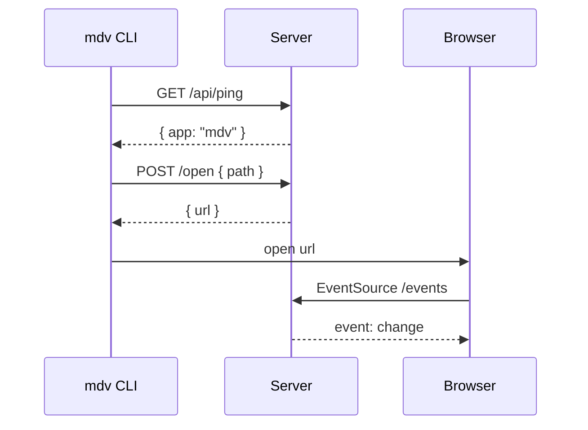

# Rendering in depth

## How highlighting works

Code is highlighted on the server with highlight.js, so pages arrive ready to read and
nothing heavy runs in the browser. Each theme maps highlight.js tokens to its own palette.

```typescript
type Theme = 'auto' | 'light' | 'dark' | 'sepia' | 'ink' | 'dusk';

function next(theme: Theme, all: Theme[]): Theme {
  return all[(all.indexOf(theme) + 1) % all.length];
}
```

## Sequence diagram



See also: [Getting started](../getting-started.md) · [Showcase](../../showcase.md)
