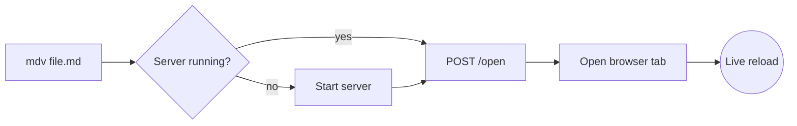

# The mdv feature showcase

A page should get out of the way. This file exercises everything **mdv** renders, so you can judge
the typography and themes with real content. Try `t` to cycle themes, `[` to hide the sidebar,
and `/` to filter files. For a second document, see [Getting started](./guides/getting-started.md)
or jump to the [deep dive on rendering](guides/advanced/rendering.md#how-highlighting-works).

## Text and inline elements

Body copy is set at a comfortable measure with generous leading. You can use *emphasis*,
**strong emphasis**, ***both***, ~~strikethrough~~, `inline code`, <kbd>⌘</kbd> + <kbd>K</kbd>,
<mark>highlighted text</mark>, H<sub>2</sub>O and E = mc<sup>2</sup>. Autolinks work too:
https://daringfireball.net/projects/markdown/ and <hello@example.com>.

Footnotes keep asides out of the main line of reading.[^measure] You can have several,
and they collect at the end of the page.[^second]

> Typography exists to honor content.
>
> — Robert Bringhurst, *The Elements of Typographic Style*

---

## Lists

- Unordered lists use quiet markers
- Items can hold **formatting** and `code`
  - Nested items indent cleanly
  - With their own markers
- A final item

1. Ordered lists keep tabular numbers
2. So that a column of digits lines up
3. Even at item ten and beyond

### Task list

- [x] Render GitHub-flavored Markdown
- [x] Highlight code on the server
- [ ] Read every book on the shelf
- [ ] Water the plants

## Tables

| Theme  | Mood           | Best for            | Links      |
| :----- | :------------- | :------------------ | ---------: |
| Light  | Clean, neutral | Daytime reading     | Blue       |
| Dark   | Calm, neutral  | Evenings, dim rooms | Sky        |
| Sepia  | Warm paper     | Long-form prose     | Deep teal  |
| Ink    | E-reader mono  | Maximum clarity     | Underlined |
| Dusk   | Deep indigo    | Late-night reading  | Lavender   |
| Moss   | Soft sage      | Long daytime reads  | Forest     |
| Fjord  | Cool slate     | Code-heavy docs     | Frost blue |
| Midnight | True black   | OLED, dark rooms    | Soft blue  |
| Solarized Light / Dark | Classic low-contrast | All-day reading | Blue |
| Gruvbox Light / Dark | Retro, earthy | Warm long reads | Teal |
| Catppuccin Latte / Mocha | Soft pastels | Gentle on the eyes | Blue |
| Rosé Pine | Muted, low glare | Evenings | Foam |
| Tokyo Night | Cool night blues | Code-heavy docs | Blue |
| Dracula | Vivid, high contrast | Night owls | Cyan |

## Alerts

> [!NOTE]
> Useful information that users should know, even when skimming content.

> [!TIP]
> Helpful advice for doing things better or more easily.

> [!IMPORTANT]
> Key information users need to know to achieve their goal.

> [!WARNING]
> Urgent info that needs immediate user attention to avoid problems.

> [!CAUTION]
> Advises about risks or negative outcomes of certain actions.

## Code

Each block shows its language and has a copy button on hover.

```javascript
// Debounce rapid file saves before re-rendering.
export function debounce(fn, ms = 120) {
  let timer;
  return (...args) => {
    clearTimeout(timer);
    timer = setTimeout(() => fn(...args), ms);
  };
}
```

```python
from pathlib import Path

def markdown_files(root: Path) -> list[Path]:
    """Every .md file under root, skipping hidden folders."""
    return sorted(
        p for p in root.rglob("*.md")
        if not any(part.startswith(".") for part in p.parts)
    )
```

```rust
fn word_count(text: &str) -> usize {
    text.split_whitespace().filter(|w| !w.is_empty()).count()
}
```

```bash
# Open a folder in mdv with the sepia theme
mdv ~/notes --theme sepia
```

```json
{
  "name": "mdv",
  "port": 4747,
  "themes": ["auto", "light", "dark", "sepia", "ink", "dusk"]
}
```

```diff
- const port = 3000;
+ const port = 4747;
```

```
A plain block with no language.
```

## Diagram



## Images

Relative images resolve from the Markdown file's own folder:


## Details

<details>
<summary>Click to expand</summary>

Hidden content, revealed on demand. Markdown works *inside* too.

</details>

[^measure]: Around 66 characters per line is the classic sweet spot for a single column of text.
[^second]: This is the second footnote. Its back-link returns you to where you were reading.

## Commands and output

Shell blocks get a `$` prompt on each command. It isn't copied, so **Copy** gives you
commands you can paste straight into a terminal. Comments and continuation lines don't get one.

```bash
# Install once, from the project folder
npm install --no-audit \
  --no-fund
mdv ~/notes --theme fjord
```

A `console` block separates commands from their output, and **Copy** takes only the commands:

```console
$ mdv --version
1.0.0
$ mdv --stop
mdv: stopped the server on port 4747
```

Name the file a block belongs to and it shows in the header:

```js title="src/debounce.js"
export const debounce = (fn, ms) => {
  let t;
  return (...a) => { clearTimeout(t); t = setTimeout(() => fn(...a), ms); };
};
```

```diff
@@ server.js @@
 const port = Number(process.env.PORT) || 4747;
-server.listen(port);
+server.listen(port, '127.0.0.1');
```

### A long file folds until you open it

```python title="tools/fold_demo.py"
def line_01(): pass
def line_02(): pass
def line_03(): pass
def line_04(): pass
def line_05(): pass
def line_06(): pass
def line_07(): pass
def line_08(): pass
def line_09(): pass
def line_10(): pass
def line_11(): pass
def line_12(): pass
def line_13(): pass
def line_14(): pass
def line_15(): pass
def line_16(): pass
def line_17(): pass
def line_18(): pass
def line_19(): pass
def line_20(): pass
def line_21(): pass
def line_22(): pass
def line_23(): pass
def line_24(): pass
def line_25(): pass
def line_26(): pass
def line_27(): pass
def line_28(): pass
def line_29(): pass
def line_30(): pass
def line_31(): pass
def line_32(): pass
def line_33(): pass
def line_34(): pass
def line_35(): pass
def line_36(): pass
```

## Reference table

| Command          | What it does                         | Default |
| :--------------- | :----------------------------------- | ------: |
| `mdv <path>`     | Open a file or folder                |     `.` |
| `--port <n>`     | Port to listen on                    |  `4747` |
| `--theme <name>` | Start with a theme                   |  `auto` |
| `--editor <app>` | App the Edit button opens            | TextEdit |
| `--no-open`      | Print the URL instead of opening it  |       – |
| `--stop`         | Stop the running server              |       – |
